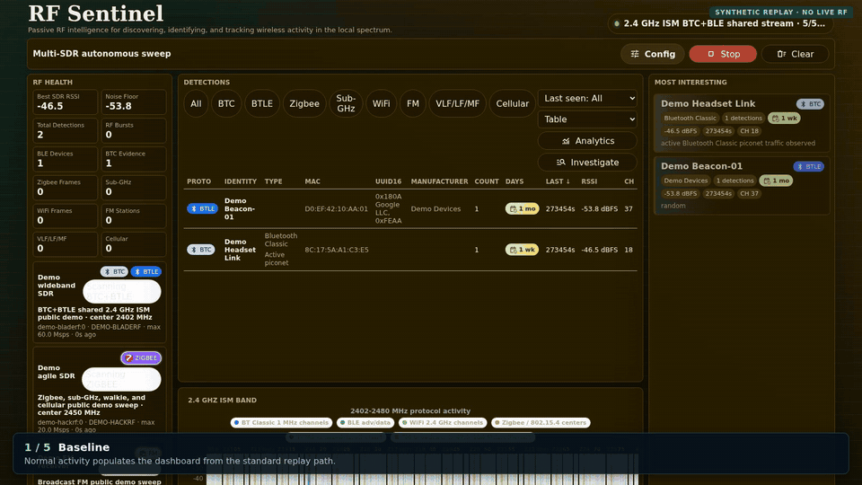
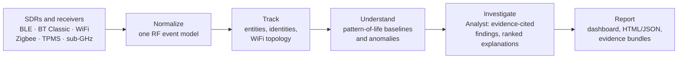
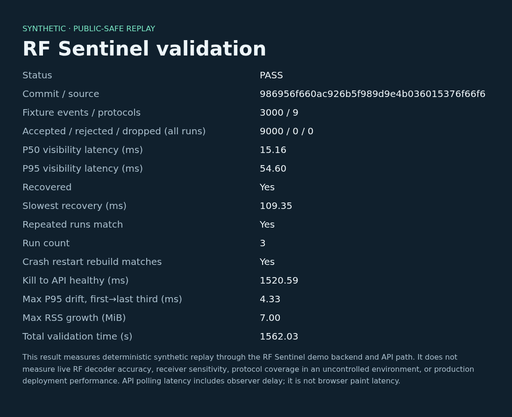
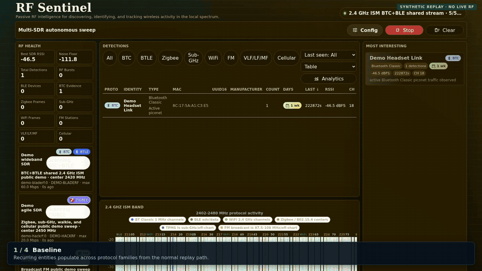
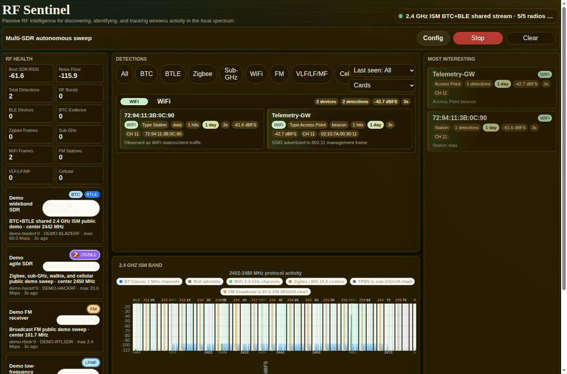
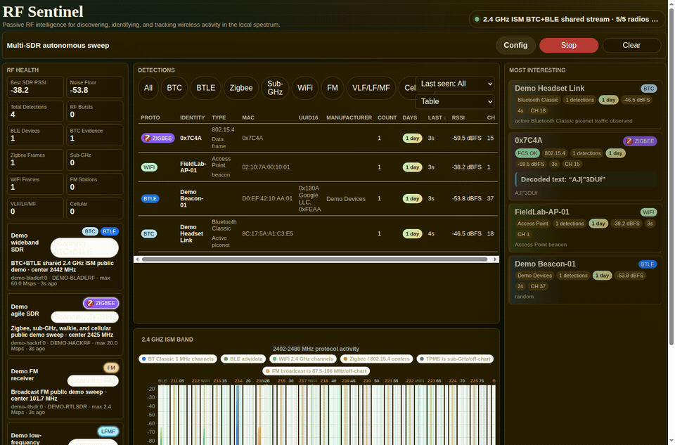
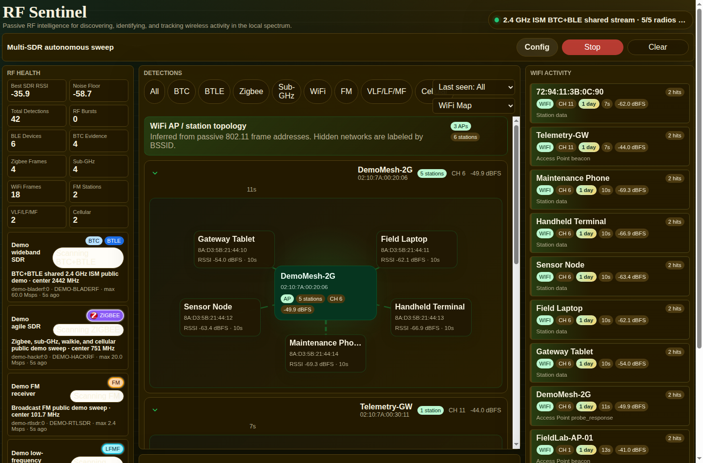
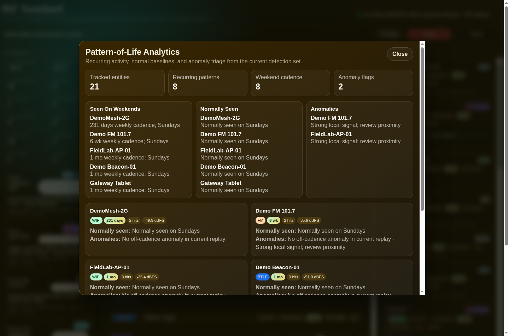

# RF Sentinel


**Passive RF intelligence: know what is transmitting around you, what changed, and the evidence behind it.**

RF Sentinel listens across Bluetooth, WiFi, Zigbee/802.15.4, TPMS and other sub-GHz activity, and wider SDR-observed bands. It turns raw signals into one picture of the devices in your environment, learns what normal looks like, and explains changes with evidence an engineer can check.

**[Request a demo or evaluation license →](https://rtgspectrum.com/contact/)** · [Try it without hardware](#try-it-yourself) · [Product page](https://rtgspectrum.com/rf-sentinel/)



<sub>Shipped dashboard on synthetic replay: set a baseline, new activity arrives, the Analyst explains what changed and links each finding to the detections behind it.</sub>

**On this page:** [Why](#why-teams-use-rf-sentinel) · [Who it is for](#who-it-is-for) · [What you get](#what-you-get) · [How it works](#how-it-works) · [Proof](#proven-with-evidence) · [Tour](#product-tour) · [Try it](#try-it-yourself) · [Work with RTG](#working-with-rtg) · [Technical reference](#technical-reference)

## Why teams use RF Sentinel

- **See every wireless device in one place.** Bluetooth, WiFi, Zigbee, TPMS, sub-GHz, and more are combined into a single picture, instead of a separate tool per protocol.
- **Know what is normal.** RF Sentinel learns which devices recur and when, so the unusual stands out.
- **Understand what changed, with proof.** The Analyst explains each change, cites the detections behind it, and weighs benign and sensor-fault explanations before suspicious ones.
- **Trust the numbers.** Performance claims come from published, reproducible measurements.
- **Stay passive.** The core product only listens.

## Who it is for

- **Facility and campus security teams** who need to know which wireless devices are normally present, and when something new or out of pattern appears.
- **Test ranges, labs, and RF engineering teams** that need repeatable, evidence-backed observation of a controlled environment.
- **Field survey and assessment teams** characterizing the wireless environment at a site.
- **Defense and government programs** that need passive RF awareness and auditable reporting.
- **Integrators and OEMs** adding multi-protocol RF awareness to their own sensors, platforms, or products.

## What you get

| Capability | What it does |
|---|---|
| **Sense** | Live receivers for BLE (channels 37–39), Bluetooth Classic (79 channels; 60 MHz bank capture on bladeRF), Zigbee/802.15.4, and sub-GHz/TPMS, with per-protocol SDR assignment and time-slicing. |
| **Normalize** | Every observation becomes a normalized RF event, regardless of receiver or protocol. |
| **Track** | Entity resolution and identity tracking: Bluetooth Classic LAP/UAP, BLE metadata and manufacturers, WiFi AP/station topology, recurring TPMS IDs. |
| **Understand** | Pattern-of-life: weekly and weekend recurrence, normal baselines, anomaly triage, strong-signal proximity review. |
| **Investigate** | The read-only Analyst finds new and missing devices, relationship and signal changes, and silent sensors. Each finding has cited evidence, ranked explanations, and proposed next steps. |
| **Prove** | Validation harness, published result card, verifiable evidence bundles, and recorded walkthroughs of the shipped dashboard. |
| **Integrate** | Docker packaging, a protocol plugin model, a JSON status API, and an optional LLM provider (local or cloud) behind the same read-only tools and checks. |

## How it works



1. **Sense.** Protocol receivers run on SDR front ends such as bladeRF and HackRF. Each protocol can have its own radio, or share one by time-slicing.
2. **Normalize.** Every observation becomes the same kind of RF event, whatever receiver or protocol produced it.
3. **Track.** Events resolve into entities: devices, access points and their stations, Bluetooth identities, and tire sensors.
4. **Understand.** Pattern-of-life analytics learn recurrence and flag what is out of pattern.
5. **Investigate.** The Analyst compares the current state with a baseline using read-only tools, checks sensor health before calling anything missing, and re-checks every cited value in code. It proposes next steps and never executes them.
6. **Report.** Results appear in the dashboard, with drill-down to the underlying detections, and as HTML/JSON reports and checksummed evidence bundles.

## Proven, with evidence

Every published number comes from a captured run. Nothing is entered by hand.

| Measured on commit `986956f` (300 s × 3 runs, synthetic replay) | Result |
|---|---|
| Events accepted / rejected / dropped | 9,000 / 0 / 0 |
| Event-to-API visibility latency, P50 / P95 / P99 | 15 / 55 / 95 ms |
| Latency drift over a run (P95, first third to last third) | 4.3 ms |
| Repeated runs produce identical conclusions | Yes |
| Backend SIGKILL and restart: healthy again / rebuilt state matches | ≈1.5 s / Yes |



Reproduce it with `./scripts/validate_demo.sh`. Verify the published bundle without Docker with `python3 scripts/verify_evidence_bundle.py <bundle>.tar.gz`; the bundle is attached to the [`validation-986956f` release](https://github.com/rtg-engineering/rf-sentinel/releases/tag/validation-986956f). The full result is in [JSON](docs/validation/latest-public-result.json), and the methodology and limits are in [`docs/validation.md`](docs/validation.md).

These results measure the platform on synthetic replay. They do not measure live RF decoder accuracy, receiver sensitivity, or performance in an uncontrolled environment. Those are characterized per deployment.

## Product tour

**Operator walkthrough.** Baseline, a new entity, a changed AP relationship, and pattern-of-life review, in about 50 seconds ([MP4](docs/media/rf-sentinel-operator-walkthrough.mp4)).



| Public demo replay | Detection table population | WiFi AP / station topology |
|---|---|---|
| [](docs/media/rf-sentinel-public-demo.gif) | [](docs/media/rf-sentinel-public-demo-table.gif) | [](docs/media/rf-sentinel-public-demo-wifi-topology.png) |

| Pattern-of-life analytics |
|---|
| [](docs/media/rf-sentinel-public-demo-analytics.png) |

| Live multi-protocol scan | Protocol group settings |
|---|---|
| [](docs/media/rf-sentinel-full-scan.jpg) | [](docs/media/rf-sentinel-protocol-settings.jpg) |

| Bluetooth Classic scan configuration |
|---|
| [](docs/media/rf-sentinel-btc-config.jpg) |

## Try it yourself

No radios required. A deterministic synthetic replay drives the real dashboard:

```bash
docker compose -f docker-compose.demo.yml up --build
```

Open `http://127.0.0.1:8080`. Use `RF_SENTINEL_DEMO_PORT=8081` if port 8080 is busy. You will see the detection table fill across protocol families, along with RF health metrics, WiFi AP/station topology, and 2.4 GHz activity. **Analytics** opens pattern-of-life review. **Investigate** sets a baseline and reports what changed. See [`docs/demo.md`](docs/demo.md) for the full workflow.

## Working with RTG

RF Sentinel is commercial software from RTG. We work with teams in several ways:

- **Evaluation.** A guided demo on your use case, then an evaluation license to run on your own hardware or with replayed data.
- **Licensing.** A commercial license for deployment in your environment or product.
- **Integration.** Connect your SDRs, sensors, or existing event sources to the normalized pipeline, dashboards, and Analyst.
- **Custom protocols and features.** New receiver plugins, reports, and deployment packaging for your mission.
- **Roadmap partnership.** Help shape persistent environment memory, bounded investigation missions with operator approval, and multi-site fleet monitoring. These are on the roadmap and not yet shipped.

**[Contact RTG to discuss your RF environment →](https://rtgspectrum.com/contact/)**

More from RTG Spectrum:

- [RF Sentinel module case study](https://rtgspectrum.com/rf-sentinel/)
- [RF Sentinel + Trace Analyzer case study](https://rtgspectrum.com/case-studies/rf-sentinel-trace-analyzer/)
- [RF signal classification software](https://rtgspectrum.com/services/rf-sensing/)

## Roadmap

| Stage | Status |
|---|---|
| Multi-protocol passive sensing, normalized events, entity tracking, dashboard, pattern-of-life | Shipped |
| Measured validation harness and published evidence | Shipped |
| Analyst: read-only, evidence-backed investigation with dashboard drill-down | Shipped |
| Persistent environment memory: versioned baselines, "what changed since the last assessment" | Next |
| Bounded investigation missions with an independent policy engine and operator approval | Planned |
| Multi-site fleet: distributed collectors with per-site baselines | Planned |

Full plans: [`docs/product_strategy.md`](docs/product_strategy.md), [`docs/architecture.md`](docs/architecture.md), [`docs/milestones.md`](docs/milestones.md).

---

## Technical reference

Everything below is for engineers evaluating or deploying RF Sentinel.

### Product definition

> A multi-protocol RF intelligence platform that passively discovers and tracks nearby wireless devices across Bluetooth, WiFi, TPMS, Zigbee/802.15.4, drone/UAS, and SDR-observed signals, with optional authorized test/effects modules for defense and lab environments.

The core product stays passive: RF discovery, protocol intelligence, entity resolution, pattern-of-life analytics, dashboards, alerts, and reports. Active replay, simulation, and effects work belongs in a separate authorized lab module with explicit controls.

The live dashboard and capture front end uses `sdr-gateway` IQ streams for BLE and Bluetooth Classic discovery, and hosts protocol plugins for additional RF families. The engineering focus is the platform layer: radio orchestration, event schemas, plugin boundaries, streaming capture, and operator-facing observability.

### Current capabilities

- BLE advertising-channel scanning on channels 37, 38, and 39.
- BT Classic single-channel scanning across channels 0 through 78.
- Classic LAP extraction from the access code.
- UAP candidate brute forcing from the packet header using the HEC/whitening procedure from the included `research/btsniffer` code.
- Per-LAP candidate pruning across repeated packets using the 625 us slot clock relationship.
- LAP identity tracking that displays `UAP XXX` until the UAP candidate set resolves.
- Optional browser-controlled channel hopping with a configurable dwell time.
- 60 MHz BT Classic bank capture on bladeRF that splits the stream into Classic channel lanes and decodes them together.
- Separate BTC and BTLE SDR selection, so BTC can use `bladerf:0` while BTLE uses `hackrf:0`.
- A 79-channel Classic activity chart with one vertical bar per channel.
- Zigbee / IEEE 802.15.4 receiver plugin under `rf_platform/plugins/zigbee-802154`.
- Sub-GHz / TPMS receiver plugin under `rf_platform/plugins/subghz-stack`.
- Multi-protocol scanner CLI that runs BTC on one SDR while time-slicing BLE, Zigbee, and TPMS on another SDR.

### Public demo mode

The hardware-free demo replays deterministic synthetic detection events into the normal dashboard. It covers Bluetooth Classic (`BTC`), BLE, Zigbee / 802.15.4, WiFi APs and stations, TPMS, walkie-style sub-GHz activity, FM broadcast, VLF/LF/MF, passive cellular awareness, and pattern-of-life analytics, without SDR hardware or committed RF captures. Demo data is generated under `.demo/events/` and excluded from version control. It shows:

- one-command Docker packaging for a live RF dashboard;
- a normalized event pipeline that ingests multiple wireless protocol families;
- entity tracking, detection counts, RF health metrics, WiFi AP/station topology, pattern-of-life cadence, and 2.4 GHz protocol activity visualization;
- a modal analytics view for weekend recurrence, normal baselines, and anomaly triage.

### Measured validation

`./scripts/validate_demo.sh` runs a hardware-free, three-run validation through the real demo backend and status API. It checks:

- event accounting and API visibility latency;
- replay pause/resume recovery, and backend SIGKILL/restart with state rebuild;
- topology, and repeatable pattern-of-life conclusions.

It writes JSON evidence, an HTML/PNG result card, and a checksummed evidence bundle under `.demo/validation/`. See [`docs/validation.md`](docs/validation.md) for prerequisites, configuration, and the distinction between synthetic platform validation and live RF performance. Regenerate the operator walkthrough with `python3 scripts/record_walkthrough.py --build`.

### Analyst (read-only investigation)

`python3 scripts/analyst_demo.py --build` replays a scripted scenario through the Docker backend, captures before/after snapshots over HTTP, and produces an evidence-backed report. The report covers what changed, the observed and computed facts behind each finding, competing explanations, and proposed next steps. Every cited value is re-checked against the evidence by code, and nothing is executed.

`python3 scripts/evaluate_analyst.py` scores the Analyst on held-out scenarios: a new device, an access-point outage, a receiver outage, and a quiet control. An optional Pydantic AI provider (`pip install -e '.[analyst-llm]'`) can plan and write the investigation through the same read-only tools and checks. In the dashboard, **Investigate** sets a baseline and reports what changed since. See [`docs/analyst.md`](docs/analyst.md); regenerate its walkthrough with `python3 scripts/record_walkthrough.py --analyst --build`.

### Project layout

- `ui/backend/app.py`: Flask API, gateway stream control, BLE detector, BT Classic LAP/UAP tracker.
- `ui/frontend/index.html`: browser UI for SDR controls, RF health, discoveries, and UAP candidates.
- `rf_platform/`: shared normalized event and entity primitives for the broader platform.
- `rf_platform/analyst/`: read-only evidence-backed investigation (tools, policy gateway, grounding, reports).
- `rf_platform/plugins/bluetooth-classic/`: Bluetooth Classic sniffer plugin.
- `rf_platform/plugins/bluetooth-lowenergy/`: BLE advertising receiver plugin.
- `rf_platform/plugins/zigbee-802154/`: Zigbee / IEEE 802.15.4 receiver plugin.
- `rf_platform/plugins/subghz-stack/`: Sub-GHz / TPMS receiver plugin.
- `docs/`: product strategy, architecture, validation, Analyst, and milestone roadmap.
- `research/`: the referenced paper and corresponding `btsniffer` code.

### Platform build order

1. Normalize all observations into `rf_platform.RFEvent`.
2. Add a SQLite event store and replay/export mode.
3. Feed BLE and Bluetooth Classic detections into the event store.
4. Feed Zigbee / 802.15.4 plugin frames into the event store.
5. Add WiFi monitor-mode ingestion.
6. Add TPMS ingestion.
7. Build entity resolution and pattern-of-life dashboard views.

### Requirements

- Python 3.10+.
- For the shared passive detection view (BT/BLE cards): a running `rfiq_daemon` instance and the shared `bt-detector` sidecar. See `rf-iq-gateway` and the "Known gap" section of `docker/README.md`.
- For the UI's own device picker and "start scan" button: a running `sdr-gateway` instance (`http://127.0.0.1:8080` by default). Without it, that UI path shows "no SDRs are available from sdr-gateway".

### Setup

```bash
cd rf-sentinel
./install.sh
```

`install.sh` creates or updates the Python venv and rebuilds the native Bluetooth Classic sniffer plugin for the current machine architecture. This matters when deploying between `x86_64` and `aarch64`, because copied binaries are not portable.

At runtime, `ui/backend/app.py` also checks the Bluetooth Classic sniffer binary before launch. If it is missing, stale, points at an old CMake source directory, or has the wrong architecture, it rebuilds automatically unless `BTC_SNIFFER_AUTO_BUILD=0` is set.

If `sdr-gateway` auth is enabled:

```bash
export SDR_GATEWAY_API_TOKEN="<your-token>"
```

Optional base URL override:

```bash
export SDR_GATEWAY_BASE_URL="http://127.0.0.1:8080"
```

### Run

```bash
cd rf-sentinel
source .venv/bin/activate
python3 ui/backend/app.py
```

Open `http://127.0.0.1:5050`.

The UI defaults to BTC enabled. For combined scanning, enable both `BTC` and `BTLE`. BTC defaults to a bladeRF device at `60` MHz and BTLE defaults to a HackRF device. The single gain slider drives both LNA and VGA gain values. Set the dwell seconds and press Start/Stop to rotate BTC banks while BTLE cycles advertising channels 37/38/39.

Run the multi-protocol CLI scanner:

```bash
rf_sentinel_scan
```

Default scanner layout:

- `bladerf:0` runs Bluetooth Classic continuously at `2442 MHz` / `60 MHz`.
- `hackrf:0` time-slices BLE, Zigbee/802.15.4, and TPMS.
- BLE uses the gateway-managed HackRF IQ sweep.
- Zigbee defaults to the known-good XBee channel 25 settings.
- TPMS auto-hops known `315 MHz` and `433.92 MHz` bands.

Example with explicit radios and shorter slices:

```bash
rf_sentinel_scan \
  --btc-device-id bladerf:0 \
  --hop-device-id hackrf:0 \
  --ble-slice-s 15 \
  --zigbee-slice-s 15 \
  --tpms-slice-s 15
```

### Docker deployment

A container build exists at `docker/`, with its own README and soapy-build assets. **See `docker/README.md`** for the production configuration that shares `rfiq_daemon`, rather than the older direct-`sdr-gateway` design. It also documents a known gap: the UI's device picker and "start scan" button still depend on `sdr-gateway` being up, even though the shared passive BT/BLE detection view does not.

### Notes

- The BT Classic implementation is based on `research/btsniffer/full-band/sources/frame-processing/btdecoder.cpp`.
- The paper's strongest setup captures many channels concurrently. This app uses one `sdr-gateway` stream at a time, so Classic resolution depends heavily on catching repeated packets for the same LAP on the tuned channel.
- A resolved UAP still gives `NAP:UAP:LAP` only as `??:UAP:LAP`. Discovering the NAP requires protocol evidence beyond this header brute-force step.

## License

RF Sentinel itself is proprietary commercial software licensed under the `RF Sentinel Commercial License`; see [`LICENSE`](LICENSE).

Some plugins are distributed under separate open-source licenses. In particular, `rf_platform/plugins/bluetooth-classic` is a GPLv3 submodule based on [`bsnet/btsniffer`](https://github.com/bsnet/btsniffer). See [`THIRD_PARTY_NOTICES.md`](THIRD_PARTY_NOTICES.md).

For licensing, evaluation, and integration, [contact RTG](https://rtgspectrum.com/contact/).
