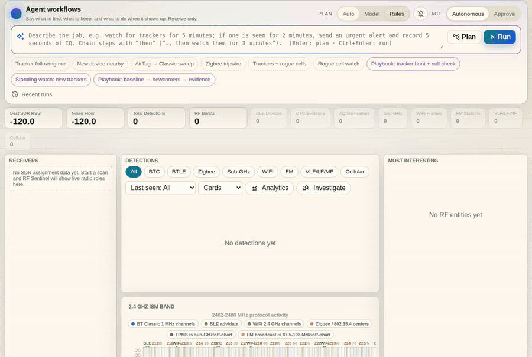

# Operator agent

Ask RF Sentinel in plain language, and it runs the collection itself. It picks a receiver, sets and corrects the gain, runs the right decoder, and reports what it found, with a verifiable run report. It **only receives**.

```bash
rf-sentinel agent run "find bluetooth devices"                    # streams steps; Ctrl+C stops the run
rf-sentinel agent run "find bluetooth devices for 2 minutes on bladerf:1"
rf-sentinel agent run "find bluetooth classic devices for 60 seconds"
rf-sentinel agent run "look for zigbee on channel 25" --json
rf-sentinel agent run "find tire sensors" --gain 30               # fixed gain, no automatic gain
rf-sentinel agent run "find bluetooth devices" --mode approval-required
rf-sentinel agent run "find bluetooth devices" --detach           # print the run id and return
rf-sentinel agent status <run-id>
rf-sentinel agent stop <run-id>
rf-sentinel agent list
rf-sentinel agent approve <run-id> <action-id> --operator NAME   # or: deny ... --reason "..."
rf-sentinel agent report <run-id>
rf-sentinel agent policy
rf-sentinel agent run "find bluetooth devices" --local            # no dashboard: run in this process
rf-sentinel agent ready "survey cell towers for 2 minutes"          # can this plan run here now? (nothing runs)
rf-sentinel agent ask <run-id> "which trackers came back every cycle?"
rf-sentinel agent library save "night watch" "from 10pm to 6am, every 30 minutes, sweep for trackers for 1 minute"
rf-sentinel agent run "run night watch"                             # a saved plan, by name
```

Runs are managed by the dashboard's run service, which is the single source of truth. A run started from the dashboard can be inspected and stopped from the CLI, and the reverse. The CLI talks to `--server`, else `RF_SENTINEL_URL`, else `http://127.0.0.1:5050`. Stopping a run ends its scan, or its gain measurement or approval wait, within about 1–2 s, and releases only that run's receiver stream.

In the dashboard, type the same request into the **Agent workflows** panel. Its steps (including every gain change) appear under *Agent steps* as they happen. Decoded devices appear in the normal detections table, and a link opens the verifiable report. The dashboard and CLI use the same agent code and the same IQ service.

## Workflows: find, keep, when → do

Describe the whole job in one sentence. The agent plans it, shows you the plan, then runs it and reacts to what it sees:

```bash
rf-sentinel agent plan "Watch for bluetooth trackers for 5 minutes, only stronger than -60. If a tracker is seen \
  for more than 2 minutes, send an urgent alert and record 5 seconds of IQ. If an AirTag appears, scan bluetooth \
  classic for 60 seconds."
Plan (deterministic)
  FIND    BLE for 300 s
  FILTER  signal ≥ -60 dBFS
  FILTER  kind is "tracker"
  WHEN    when kind is "tracker" and seen for ≥ 120 s → alert (critical), record 5 s of IQ evidence
  WHEN    when identity contains "AirTag" → scan Bluetooth Classic for 60 s
```

In the dashboard, the **Agent workflows** panel does the same:
- **Plan** shows *Find / Keep / When → Do* cards and says which planner produced them. You can remove a filter or rule (×) and change the duration (− / +). The server re-validates every edit.
- **Act** chooses **Autonomous** (act within bounds) or **Approve**. In Approve mode, each hardware action (starting a scan, recording IQ, extending the run) appears as an approval card. You approve or deny it under your name, and the decision goes into the audit.
- **Run** shows live progress, a detections-per-second sparkline, per-protocol counts, an alert stack (critical alerts in red), the matching devices (alerted and tagged ones first), and a timeline of matches, rules and actions. When the run ends, a **What happened** summary appears. It is built only from the run's own records, and is also printed by the CLI and included in the report.
- **Recent runs** lists earlier runs with *Report*, *View* and *Run again*. Reloading the page resumes a run in progress.

**SDR + modem in one workflow.** A workflow can combine one SDR protocol group (BLE with Bluetooth Classic, or Zigbee, or TPMS) with the cellular modem, for example:

> "Watch for trackers and rogue cell towers for 3 minutes. If an AirTag is seen for more than 1 minute, send an urgent alert. Send an urgent alert if an unknown network appears or if a 2G cell shows up."

Filters are scoped per source. Cell fields (operator, RAT, generation, role) filter cells, and the other filters (tracker kind, dBFS signal, …) filter SDR devices. When several rules match the same device at the same moment, the result is one alert that lists every reason.

**Simulation.** `rf-sentinel agent run "…" --simulate` (or `RF_SENTINEL_AGENT_SIMULATE=1`) replaces the receivers with two simulated ones. A scripted scenario plays out:
- a crowd of phones and accessories;
- a separated AirTag that appears and lingers;
- a strong newcomer;
- serving-cell changes;
- a 2G cell on the test network PLMN 001-01.

The gateway, approvals, workflow engine, evidence and reports are the real ones. Runs, reports and the UI are labelled **SIMULATED**. The dashboard's synthetic demo uses simulation for agent runs.

**Planning.** A request becomes a typed `WorkflowSpec` (`rf_platform/agent/workflow.py`), made of three parts:

| Part | Contents |
|---|---|
| Collect | Protocols and duration. |
| Filters | Conditions on signal, vendor, device kind (tracker, beacon, phone, …), identity, name, how long or how often a device has been seen, and whether it is **new** (never seen in earlier runs). |
| Triggers | `when <conditions> → <actions>`, firing once per device, or every time (with a cooldown) for "whenever". |

Two planners produce the same spec:
- **Rules** (deterministic, always available): a fixed grammar for phrases like "only stronger than -60", "from apple", "if a tracker is seen for more than 2 minutes", "whenever a phone is seen 5 times", "stop when anything shows up", "in the next 3 minutes".
- **Model** (optional; Pydantic AI). It uses `RF_SENTINEL_PLANNER_MODEL`, else Claude when `ANTHROPIC_API_KEY` is set, else a local Codex login. If the model is unavailable or returns something invalid, planning falls back to the rules and says why. **Auto** (the default) tries the model first.

**What a model can and cannot do.** It only proposes a spec. The spec is validated against the schema and its bounds:
- duration ≤ 600 s;
- IQ capture ≤ 10 s;
- follow-up scans ≤ 300 s;
- one protocol per run, except BLE + Classic.

The server validates it again when the run starts. Every action is authorized by the run's tool gateway, so mode, approvals and audit apply exactly as for any other operation. Gain, receivers, permissions and evidence stay in deterministic code. Transmit-like requests are refused before planning.

| Action | Gateway tool | Notes |
|---|---|---|
| `alert` | `raise_alert` (control) | Banner and toast in the dashboard, `ALERT` step in the CLI, listed in the report. |
| `tag` | `tag_device` (control) | Label on the device in results. |
| `record_iq` | `record_iq` (collect) | Up to 10 s on a **free** receiver, on the device's channel. Captures queue for a receiver. Written with a `.json` sidecar including sha256, and listed in the report. |
| `start_scan` | `start_scan` (collect) | A follow-up scan on a free receiver (e.g. Classic when an AirTag appears). |
| `extend` | `extend_scan` (collect) | Lengthens this run, never past 600 s in total. |
| `stop` | `stop_scan` (control) | Ends collection early and reports normally. |

In `observe` mode, collect actions are denied; alerts and tags still work.

**Alerts off this machine.** Set `RF_SENTINEL_ALERT_WEBHOOK` to have workflow alerts also posted to a webhook. Delivery is off unless it is set.
- Slack-style hooks receive `{"text": …}`.
- An `ntfy.sh/<topic>` URL receives plain text with a priority header.
- `RF_SENTINEL_ALERT_MIN_SEVERITY` (`info`, `warning` (the default), or `critical`) sets the lowest severity that is sent.

Each message carries the alert text, severity, device label and run id, and is marked `[SIMULATED]` when the run is simulated. It never includes IQ or evidence files. Each delivery goes through the gateway as `deliver_alert` (audited) and appears in the run's timeline as sent or failed. A failed delivery never affects the run. The dashboard shows the webhook host next to the notification bell. In `approval-required` mode, each collect action waits for a named operator.

**Measured live** (two bladeRF 2.0 micro):
- "Find ble devices for 60 seconds, only stronger than -60. When a device is seen 5 times, alert me and tag it as persistent. If an Apple device appears, record 2 seconds of IQ."
- 5 devices matched (Microsoft, Apple ×2, Tile, Bose), 5 alerts and tags.
- 2 s of IQ was captured on the second receiver when an Apple device appeared, with a hashed evidence file.

## Playbooks: a whole operation in one request



*Recorded with `python3 scripts/record_agent_walkthrough.py`. The script starts its own dashboard with simulated receivers, so it needs no radio. [MP4](media/rf-sentinel-agent-playbook.mp4).*

Chain workflows with *then*, *after that*, *next*, *finally*, or a numbered list. Each step is an ordinary workflow (find / keep / when → do). A step can also build on the steps before it:

| You say | The step |
|---|---|
| "watch **them**", "the apple devices **you found**", "any trackers you saw" | focuses on the devices an earlier step matched, and ignores everything else |
| "the **flagged** ones", "the alerted ones" / "the **tagged** ones" | focuses on devices that raised an alert / were tagged |
| "**if you find any** trackers, …", "if anything turns up, …" | runs only if the earlier step matched such a device |
| "**if nothing turns up**, …", "if you see nothing, …" | runs only if it did not. After a step with only alert rules, this means "if no alert fired" |
| "if any alerts were raised, …", "if something alerted, …" | runs only if the earlier step alerted |
| "**otherwise**, …" | the inverse of the previous step's condition, about the same earlier step |

A step that names no protocol continues with the protocol of the step it builds on. An action with no condition of its own ("and tag them as suspect", "record 3 seconds of IQ") applies to every device the step keeps.

```bash
rf-sentinel agent plan "Sweep for bluetooth trackers for 2 minutes. If you find any, watch them for 5 minutes and \
  send an urgent alert if one is still there after 3 minutes, and record 5 seconds of IQ. Then survey cell towers \
  for 1 minute and alert me if a 2G cell shows up."
Playbook (deterministic)
  1. Sweep BLE
     FIND    BLE for 120 s
     FILTER  kind is "tracker"
  2. Follow up on what was found (BLE)
     IF      only if step 1 found something
     FOCUS   devices from step 1
     FIND    BLE for 300 s
     WHEN    when seen for ≥ 180 s → alert (critical), record 5 s of IQ evidence
  3. Survey Cellular
     FIND    Cellular (modem) for 60 s
     WHEN    when generation is "2G" → alert (warning)
  up to 480 s of collection
```

The steps run in order under one gateway (mode, approvals, audit) and one stop control. A playbook has at most 6 steps and 1800 s of collection; a longer request is refused, never shortened. Tags travel with a device into later steps. The result lists, for every device, the steps that decoded it, and calls out **persistent** devices (decoded in more than one step, alerted and tagged ones first). One verifiable report covers the whole playbook.

In the dashboard, a playbook plan is a numbered pipeline: each step shows its condition and focus, and its duration can be changed. While it runs, a stepper shows each step as waiting, running (with how many devices it focuses on), done (with its results), or skipped (with the reason). The timeline marks which step each event came from. The two playbook example prompts show the flow. In simulation, all the steps share one scripted scenario clock, so the strong newcomer arrives part-way through, as it would live.

**Planning quality.** `tests/fixtures/playbook_phrases.json` holds 17 reviewed multi-step requests and 2 that must be refused. Each request is recorded with the exact plan it must produce. `python3 scripts/evaluate_planner.py --playbooks [--model …]` scores a planner per step part:
- **Rules planner:** 17/17, with 2/2 refusals.
- **Model planner** (`openai-codex:gpt-6-astra`), live:
  - 16/17, with 2/2 refusals and no fallbacks.
  - The one miss gates on "found a tracker" instead of filtering for trackers. That is the same devices, reached a different way.
  - The guidance was refined on the first 12 requests. The last 5 were written afterwards as a held-out check.

Whether a request has steps is decided by the rules (sequencing words and step verbs). A single request always plans exactly as before; the 30-phrase workflow corpus is checked for that.

**Standing watches.** A watch repeats a whole playbook on a schedule:

> "Every 10 minutes for the next 2 hours, sweep for bluetooth trackers for 1 minute and send an urgent alert when a new one appears."

Other phrasings it understands:
- "…, repeat 4 times, every 15 minutes"
- "…, every hour until I stop it" (with no end given, the watch runs as many cycles as fit within the limits)

**Scheduled starts.** A playbook or watch can begin later:
- "In 20 minutes, …" waits 20 minutes after **Run**.
- "At 10pm, …", "tonight at 10, …" or "at 22:30, …" waits for the next time that clock time comes round.
- "From 10pm to 6am, every 30 minutes, …" sets both the start and the window, so this example runs 16 cycles.

Clock times use the operator's time zone: the dashboard sends the browser's, and the CLI uses the machine's. The plan shows the resolved zone. A bare "at 10" is not taken as a time; give am/pm or hh:mm. A start can be at most 24 h ahead. While a run waits, it shows a countdown and can be stopped.

Cycles start on the schedule (start to start), and **Stop** ends the watch even while it is waiting. If the first cycle cannot run any step, for example because there is no receiver, the watch ends at once instead of waiting through the remaining cycles.

Results:
- A "new" rule fires only for devices that no earlier cycle (or run) has seen. A watch therefore alerts on arrivals, not on the same crowd every cycle.
- **Recurring** devices are those decoded in two or more cycles, with how many cycles and over how long.
- The dashboard shows the cycles (alerts marked), a countdown to the next cycle, and a recurring-devices card. The report has a per-cycle table.

Limits:
- cycles start 60 s to 6 h apart;
- at most 48 cycles;
- the watch ends within 12 h;
- a cycle must fit within the interval.

A request beyond a limit is refused with the reason.

**Ready?** Under every plan, a row of checks says whether it can run here right now (`POST /api/agent/readiness`):
- the IQ service and a receiver for each SDR band;
- the Bluetooth Classic decoder;
- the cellular modem;
- disk space for reports and IQ evidence;
- Approve mode on an unattended watch;
- whether alerts reach anywhere but this screen.

The probes are read-only: no receiver is opened. Run them before leaving a watch overnight.

**Surviving restarts.** While a scheduled playbook or a standing watch runs, it is recorded in `<log dir>/agent-runs/active/`. If the dashboard restarts, the watch resumes from its next scheduled cycle, in the same mode, and is marked *resumed*. A cycle that was in progress when the dashboard stopped is not re-run, and its results are lost. A run that ends normally, or is stopped, is no longer recorded there.

**Ask about a run.** When a run has finished, including runs loaded from **Recent runs**, an *Ask* bar takes questions such as "what alerted?", "which trackers came back every cycle?", "what was strongest?" or "why was step 2 skipped?" (`POST /api/agent/jobs/<id>/ask`).
- **With a model:** the model answers, and it can read the run only through tools (overview, devices, alerts). Its answer is then checked by code: every device it cites must be one the run recorded, and every number must appear in what the tools returned.
- **Limit of the check:** it rejects invented devices and readings, but it cannot prove a small count the model worked out itself. "8 devices appeared in every cycle" passes if 8 occurs anywhere in the records. For exact counts, ask the code path (planner *Rules*).
- **Live, on a simulated standing watch:** 6 of 6 `gpt-6-astra` answers passed the check. Where the records lacked the information, the model said so instead of guessing.
- **Without a model, or if the check fails:** code answers the common questions from the run's records, and the answer states the reason.

**Saved plans.** **Save** under a plan stores it by name on the server, so the dashboard and the CLI share it. Typing "run tonight's watch" (or clicking the saved plan) loads that plan, re-validated, without planning again; `rf-sentinel agent library` lists saved plans. Saved plans live in `<log dir>/agent-runs/library.json`.

**Limits:** devices are followed from step to step by address. BLE devices that rotate their random address can therefore look new in a later step; phones and AirTags rotate about every 15 minutes. "Seen for" (dwell) is counted within a step.

## What it does

1. **Understands the request.** Supported: Bluetooth Low Energy ("BLE", "beacons", "AirTag"), Bluetooth Classic ("bluetooth classic", "BR/EDR"), Zigbee / 802.15.4, TPMS tire sensors, and cell towers through a cellular modem ("cell towers", "LTE", "5G"). A plain "bluetooth" request covers both kinds of Bluetooth (see [Bluetooth Classic](#bluetooth-classic)). It understands durations ("for 2 minutes", up to 600 s), a receiver ("on bladerf:1"), and a Zigbee channel. Requests to transmit, jam, spoof, or replay are refused. WiFi needs a monitor-mode adapter, not an SDR, so the agent says so.
2. **Chooses a receiver.** A free receiver whose tuning range and sample rate cover the band, from the IQ service. It uses the built-in SoapySDR service by default ([sdr.md](sdr.md)).
3. **Level-based gain.** It measures received samples on every center frequency, then steps the gain to the highest value where the 99.9th-percentile magnitude is within 3 dB of -6 dBFS and under 0.1% of samples clip. The loudest channel decides, so the gain is safe everywhere.
4. **Decoder-feedback gain.** While the decoder runs, the agent checks the decoder's own burst peaks every 8 s:
   - if more than 20% of bursts reach full scale, it lowers the gain 6 dB;
   - if bursts are weak (median peak below -18 dBFS), it raises the gain 6 dB.

   Each change restarts the receiver and is reported, with up to four changes per run.
5. **Reports.** Detections are grouped per device: count, best RSSI, identity, manufacturer, and frame type. Each run writes `run.json`, `report.html`, and `checksums.sha256` under `.demo/agent-runs/<run>` (dashboard: `<log dir>/agent-runs`). Check the files with `sha256sum -c checksums.sha256`.

Gain control is deterministic code; no model guesses gain values. Clipping is **measured** from received samples. Front-end overload is **inferred** from it.

## Cellular survey (modem, not an SDR)

A Quectel RM520N-GL cellular modem on USB adds cell-network awareness:
- serving and neighbour cells every few seconds;
- a full network scan (`AT+QSCAN`) about every 90 s;
- for every cell: operator (from MCC-MNC), RAT (2G–5G NR), cell ID, PCI, ARFCN, TAC, and RSRP / RSRQ / SINR.

```bash
# The companion rm520n-survey service owns the modem (its own repo), on :5098 by default
CELLULAR_SURVEY_PORT=/dev/ttyUSB3 python ui/backend/app.py          # in rm520n-survey
rf-sentinel agent run "survey cell towers for 3 minutes"
rf-sentinel agent run "Survey cell towers for 3 minutes. Send an urgent alert if an unknown network appears \
  or if a 2G cell shows up, and alert me when the serving cell changes."
```

- **How it connects.** RF Sentinel reads cells from the survey service's HTTP API (`RF_SENTINEL_CELL_SURVEY_URL`, default `http://127.0.0.1:5098`), the same way it reads radios from the IQ service. `python -m rf_platform.cellular` is the adapter the agent runs; it emits one JSON `cell` event per observation.
- **Capability check.** The agent confirms the service answers and sees a modem answering AT commands. If not, it says what's missing. If ModemManager is running, it may hold one AT port; use the other (`ttyUSB3` on the RM520N).
- **Receive-only only without a SIM.** With no SIM the modem does not register on any network: it camps on cells and scans. **With a SIM inserted it registers like a phone, which transmits.** The capability result says so on every run.
- **PLMN checks.**
  - The full scan is treated as authoritative for a cell's network.
  - A serving-cell report whose PLMN hasn't been confirmed by a scan is shown as *unverified PLMN*, not *unknown operator*. Some modem serving-cell reports carry a mis-parsed PLMN, and an "unknown network" trigger must not fire on that.
  - Neighbour reports that carry no PLMN are shown as *PLMN not reported*.
- **Workflow fields.** `operator`, `rat`, `generation` (2G–5G), and `role` (serving / neighbour / scanned). For cells, signal is RSRP in dBm.
- **Rules-planner phrases:**
  - carrier names ("only verizon");
  - "unknown network/operator";
  - "a 2G cell", "downgrades to 2G";
  - "when the serving cell changes";
  - "new cell stronger than -90".
- **Dashboard.** Cells appear in the **Cellular** tab and the entity tables. RSRP (dBm) is kept separate from SDR dBFS health figures.
- **Measured here.** With no SIM, a 2-minute run saw 24 cells across AT&T, FirstNet, Verizon and T-Mobile (LTE and 5G NR). It also saw 4 serving-cell changes while the SIM-less modem re-camped.

## Bluetooth Classic

Before running Classic, the agent checks that this installation can actually do it:
- the `bluetooth-classic` plugin is installed;
- its native decoder is built, or cmake is available to build it on first use;
- a free receiver covers 2.4 GHz at 20 MS/s or more.

The result is recorded in the run under `capabilities` and shown in the report.

- **"find bluetooth devices".** BLE runs on one receiver and Classic on a second one, in parallel, for the same duration. Steps from the Classic side are prefixed `[Classic]`, and devices from both are listed together, each with its `protocol`. If Classic can't run (for example, only one receiver is attached), the agent says why and runs BLE only.
- **"find bluetooth classic devices".** If Classic is unavailable, the agent reports the limitation and runs BLE instead.
- **What it captures.** 20 of the 79 Classic channels (2432–2452 MHz). Classic hops across all 79, so every active piconet appears, at about a quarter of its packet rate. Devices are keyed by LAP (the lower 24 bits of the address). A full address needs a passive FHS packet.
- **Receive-only.** The agent runs the plugin's `listen` mode, reading IQ from the IQ service. The plugin's `page-stimulus` mode transmits, and the agent never invokes it; `page_stimulus` is also on the gateway's never list.

**Measured on synthetic Classic packets** (`scripts/synth_classic_iq.py`): 300 access codes with known LAPs, at 15 dB SNR per channel, through the unchanged native decoder.

| Stream | Access codes decoded |
|---|---|
| Continuous | 58 (19%) |
| 1 sample lost every 508 | 25 (8%) |
| 4 samples lost every 508 | 8 (3%) |
| 20 samples lost every 508 | 0 |
| Continuous, 8 dB SNR | 0 |

The SoapyBladeRF overrun loses data after every 508-sample message (see [sdr.md](sdr.md)). The agent reads Classic through the IQ service's continuous native path instead.

**Decoder throughput.** At 20 MHz the native decoder runs at about 0.7× real time. That was measured both offline and live, where it processed 68% of a 30 s stream. The IQ service skips ahead when a reader falls behind, so about a third of the stream is not examined. Every run reports this as `realtime_coverage` under the Classic decoder stats, and a step says so when it is below 95%. Narrower bands use a slower filter-bank path, so they don't help.

The decoder is also the next limit on sensitivity: it samples each symbol once, at a fixed timing phase. A Python emulation of the same pipeline that tries every timing phase recovered about three quarters of the packets.

## Operating modes

Every agent operation is authorized by the tool gateway (`rf_platform/agent/gateway.py`) in the backend. The same rules apply whether a request comes from the dashboard, the CLI, or the API.

| Mode | Read tools (receivers, runs, reports, detections) | Gain optimization, starting a scan, changing gain | Stopping its own scan |
|---|---|---|---|
| `observe` | allowed | **denied** | allowed |
| `approval-required` | allowed | **each operation waits for a named operator's approval** | allowed |
| `passive-auto` | allowed | allowed, within bounds | allowed |

- **Ceiling.** The server sets `RF_SENTINEL_AGENT_MODE` (default `passive-auto`; an unrecognized value fails closed to `observe`). A run may request the same mode or a more restrictive one. A request for a more privileged mode is capped.
- **Approvals.** Each approval is bound to one pending operation of one run, by action ID and content hash. It needs a named operator, can be used once, and expires (default 300 s). Stopping the run cancels it. A denied gain change leaves the scan running at its current gain.
- **Never available.** Transmit-capable operations (`transmit`, `page_stimulus`, `replay`, `jam`, `spoof`) and raw access (`shell`, `raw_driver`, `write_register`) are not tools. Requests for them are refused in every mode.
- **Direct API.** `POST /api/agent/tools/<tool>` runs read tools. Collection tools return `403` where the mode denies them, and `409` otherwise, because collection must go through a run so that it is bounded, owned, and audited.
- **Audit.** Every decision (allowed, denied, approval requested, approved or denied by whom, expired, or cancelled) is recorded in the run.

## Why two stages of gain

On two bladeRF 2.0 micro units at 2.4 GHz, the strongest signals were WiFi. Level-based control alone kept the WiFi peaks below clipping at about 33 dB, but BLE bursts were then weak (median peak around -25 dBFS) and decoded rarely. The decoder feedback raised the gain to 46–51 dB, where BLE advertisements decoded. That matches the best gain found by manual testing (about 50 dB).

## Safety and limits

- Receive-only, one run at a time, bounded duration. The receiver stream is released when a run ends (verified: no streams left on the service after runs).
- Bluetooth Classic runs only when the capability check passes. Live Classic decoding has not yet been validated against known Classic traffic here; the numbers above are from synthetic packets.
- The dashboard agent is disabled in demo mode, since there are no radios.
- Decode yield depends on the RF environment and on decoder sensitivity. In a 45 s run here, it found 2–3 devices.
