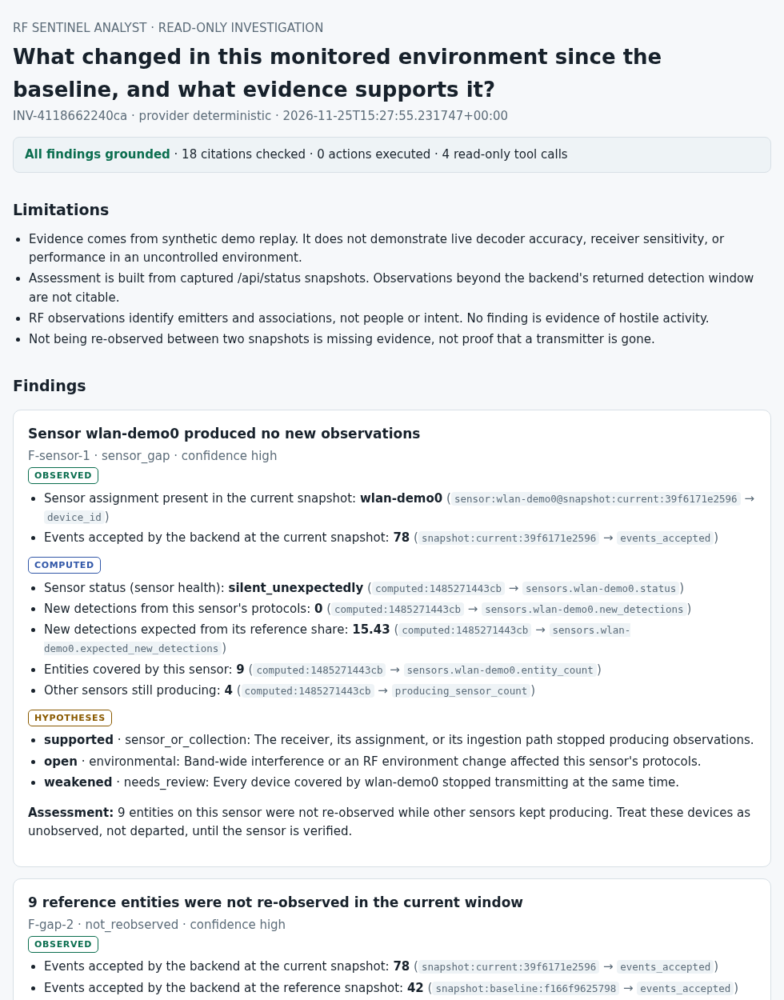

# RF Environment Assessment Pilot

A fixed-scope engagement that shows what RF Sentinel finds in **your** environment, or in your recorded data, and delivers a reproducible evidence report you can check line by line.

**[Discuss a pilot with RTG →](https://rtgspectrum.com/contact/)**

## What the pilot answers

1. Which wireless devices and networks are normally present, and when?
2. What changed during the assessment window: new devices, devices no longer heard, changed associations, unusual signal strength?
3. For each change, what is the evidence, and which explanations fit it? This includes benign causes and collection faults, not only suspicious ones.
4. What would a production deployment need: sensors, coverage, integration, and operations?

## How it runs

| Step | What happens | You see |
|---|---|---|
| 1. Scope | We agree on the authorized environment or data, objectives, data handling, and written success criteria. | A one-page scope |
| 2. Connect | Connect one authorized source. Either RF Sentinel receivers run on supported SDR front ends, or your existing event source or recorded data is mapped to RF Sentinel's normalized event model. | The dashboard showing your data |
| 3. Baseline | Capture what normal looks like over the agreed window. | A baseline snapshot and pattern-of-life view |
| 4. Monitor | Collection continues. Where you can, plan known changes (a device added, moved, or switched off) so detection can be scored against ground truth. | Live dashboard and Analyst findings |
| 5. Deliver | We investigate changes since the baseline, then hand over the report and evidence and walk through it with your team. | The deliverables below |

## What you receive

- **Evidence report (HTML and JSON).** Each finding separates observed facts, computed results, and ranked explanations. Every cited value is re-checked by code, and the report states its own limitations. See the samples below.
- **Evidence bundle.** Snapshots, observations, tool audit, findings, and report, with SHA-256 checksums, so your team can verify them independently.
- **Collection health summary.** Which sensors produced data, any gaps, and how those gaps affect the conclusions.
- **Scored results**, where planned changes were made: which known changes were found, and any false findings.
- **Deployment recommendations.** Coverage, hardware, integration points, and the operational work a production rollout would need.
- **Environment memory file.** The append-only record of every baseline, assessment, and operator note from the pilot. You can re-verify any assessment later.
- **Readout session** with RTG engineers.

## Sample deliverables

These come from RF Sentinel's held-out synthetic scenarios, generated by the shipped software and unedited. Download a folder and open `report.html`; check its integrity with `sha256sum -c checksums.sha256`.

| Sample | What it shows |
|---|---|
| [`samples/analyst/new_entity`](samples/analyst/new_entity) | A new BLE device, a WiFi station changing access points, and a strong-signal reading, each with cited evidence and alternatives. Devices not heard again in a short window are reported as missing evidence, not as departed. |
| [`samples/analyst/wifi_sensor_outage`](samples/analyst/wifi_sensor_outage) | All WiFi activity stops while other sensors keep working. The report identifies a likely collection fault on the WiFi receiver, instead of claiming nine devices left. |

## What you provide

- Written authorization for the environment or data being assessed.
- Either site access for passive sensors, or recorded data or an event feed.
- A technical point of contact, and agreement on how data is handled and retained.

## Not included

These are out of scope for a pilot, or are separate work:

- Certification of live decoder accuracy or receiver sensitivity. These are measured during the pilot for your configuration, not assumed.
- Any active RF transmission. RF Sentinel's core product is passive.
- Unattended or autonomous actions. Recommendations are proposals that need operator approval.
- Identification of people or attribution of intent. RF observations identify emitters and associations.
- Production support terms, which are agreed separately with a license.

## Hardware and deployment notes

- **Radios used in RTG's own testing:** bladeRF (Bluetooth Classic 60 MHz bank capture) and HackRF (BLE, Zigbee/802.15.4, and TPMS by time-slicing). Other SoapySDR-supported front ends are assessed per pilot.
- **Hosts:** Linux, `x86_64` and `aarch64`. The Bluetooth Classic receiver is rebuilt for the target architecture by `install.sh`.
- **Packaging:** Docker images for the dashboard and the receiver stack. Any SoapySDR-supported receiver works through the built-in IQ service ([`sdr.md`](sdr.md)). See [`docker/README.md`](../docker/README.md) for the station configuration.
- **Data stays local.** The dashboard and the deterministic Analyst run on site. Any LLM-assisted analysis is optional, and is enabled only with your approval of the model and data handling.

Scope, duration, and pricing are set after a short discovery call about your environment and objectives.

**[Contact RTG →](https://rtgspectrum.com/contact/)**
